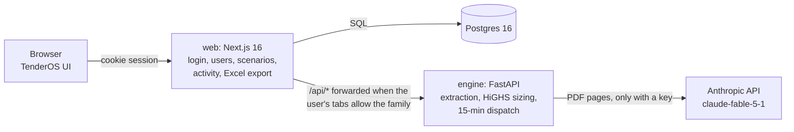

# Architecture

| Part | Folder | What it does |
| --- | --- | --- |
| Web app | `web/` | The TenderOS interface (the jouleWise design). It holds the shell with its tabs, sign-in, users and tab access, saved scenarios, the activity log, tender readings and the Excel exports. The browser computes the financial models (`web/src/rtc/engine.js`, `web/src/bid/model.js`, `web/src/cfd/`). |
| Engine | `engine/` | A stateless FastAPI service. It reads tenders (`extraction/`), runs the BESS tender adapter (`bess/`), sizes plants with the HiGHS LP (`sizing/rtc_lp.py`) and runs the 15-minute dispatch (`sizing/dispatch15.py`). |
| Database | Postgres | Holds users, sessions, tab access, scenarios, activity, resource profiles and tender readings (`web/db/migrations`, applied by the web app on start). |

On a VM, Caddy (`deploy/docker-compose.vm.yml`, `deploy/Caddyfile`) terminates HTTPS in front of
the web app and is the only published service (`docs/DEPLOY.md`).

## Tabs

| Tab | Engine route families | Purpose |
| --- | --- | --- |
| Tender to Bid | `bid`, `rtc` | Takes a tender to a sized plant and a priced bid in six steps (`docs/TENDER_TO_BID.md`) |
| Round the clock | `rtc` | RTC and FDRE sizing and finance with your own inputs |
| BESS tender | `bess` | Standalone battery tenders: reads the tender, sizes the battery and computes the finance |
| CfD bid | none | SECI CfD-I strike price, computed in the browser (`docs/CFD.md`) |

An administrator grants tabs per user. The web proxy (`web/app/api/[...path]/route.js`) forwards
`/api/<family>/…` to the engine only when one of the user's tabs needs that family
(`mayCallEngine` in `web/lib/tabs.js`). The engine has no published port of its own: in compose
only the web app is published, and `ANTHROPIC_API_KEY` lives only on the engine.

## Tender to Bid data flow

1. Upload a tender. The upload goes to `POST /api/bid/tender/read` (a job) and then
   `GET …/read/{id}`, and comes back as a reading where every value has a page and a quote.
2. `tenderMap.js` (`buildProposals`, `tenderTerms`) turns the reading into terms: capacity and bid
   limits, supply floors, peak hours, permitted and mandatory sources, market sale, PPA term and
   ceiling. A term is used only when its quote is located on the page; otherwise the reviewer
   must tick it.
3. The bidder enters sources, costs and financing (or fills in the benchmarks).
4. `lpPayload` sends the request to `POST /api/rtc/lp`. HiGHS returns the least-tariff plant as an
   NDJSON stream with progress lines, and the browser builds the tender conditions table from it.
5. `POST /api/bid/dispatch15` runs the 15-minute dispatch for every PPA year and offers a ZIP.
6. The financial model runs in the browser. `POST /api/bid/model` (a Next route) writes the Excel
   workbook.

## Tests

| Command | Covers |
| --- | --- |
| `make test` | engine unit and API tests (`tests/engine`) and the NHPC reading end to end (`tests/e2e/test_nhpc_tender.py`) |
| `make check-web` | the browser models in node (`tools/check_*.mjs`) |
| `make e2e` | the browser end to end on the NHPC RfS against a running stack (`tests/e2e/test_tender_to_bid.py`) |

## What is not here

These parts of the FDRE repository were deliberately not carried over:

* the older RTC, FDRE and EYA screens and their Python backends (`react_demo`, `fdre_*.py`);
* the product page;
* the Day 1 to 7 platform work on the FDRE `claude/laughing-pascal-7akw12` branch: projects,
  immutable runs, the audit chain, the assistant, voice and the post-award DPR.

tender_engine's review workflow (approvals, canonical facts, corrigendum versions) also stays in
tender_engine. This app uses only its extraction engine.
