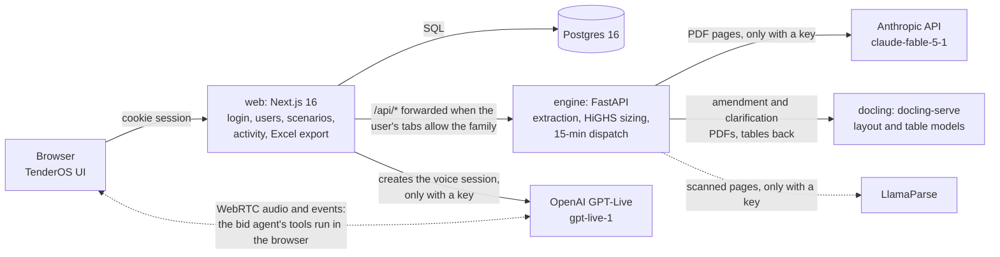

# Architecture

| Part | Folder | What it does |
| --- | --- | --- |
| Web app | `web/` | The TenderOS interface (the jouleWise design). It holds the shell with its tabs, sign-in, users and tab access, saved scenarios, the activity log, tender readings and the Excel exports. The browser computes the financial models (`web/src/rtc/engine.js`, `web/src/bid/model.js`, `web/src/cfd/`). |
| Engine | `engine/` | A stateless FastAPI service. It reads tenders (`extraction/`), runs the BESS tender adapter (`bess/`), sizes plants with the HiGHS LP (`sizing/rtc_lp.py`) and runs the 15-minute dispatch (`sizing/dispatch15.py`). |
| Docling | `docling` service (image `docling-serve-cpu`) | Reads the tables of a tender set's amendments and clarifications for the engine (`DOCLING_URL`); not published. Without it the engine uses PyMuPDF's table finder. |
| Database | Postgres | Holds users, sessions, tab access, scenarios, activity, resource profiles and tender readings (`web/db/migrations`, applied by the web app on start). |

On a VM, Caddy (`deploy/docker-compose.vm.yml`, `deploy/Caddyfile`) terminates HTTPS in front of
the web app and is the only published service (`docs/DEPLOY.md`).

## Tabs

| Tab | Engine route families | Purpose |
| --- | --- | --- |
| Tender to Bid | `bid`, `rtc` | Takes a tender to a sized plant and a priced bid in six steps (`docs/TENDER_TO_BID.md`) |
| SECI RTC tender | `rtc`, `bid` | SECI RTC-TM-V: the RfS, its amendments and clarifications, the bid conditions, what to bid, sizing against the time-block floors, the financial model with the quoted tariff checked against the target IRR, the RfS's bid formats filled and reviewed, and a GPT-Live voice bid agent (`docs/SECI_RTC.md`) |
| Round the clock | `rtc` | RTC and FDRE sizing and finance with your own inputs |
| BESS tender | `bess` | Standalone battery tenders: reads the tender, sizes the battery and computes the finance |
| CfD bid | none | SECI CfD-I strike price, computed in the browser (`docs/CFD.md`) |

An administrator grants tabs per user. The web proxy (`web/app/api/[...path]/route.js`) forwards
`/api/<family>/…` to the engine only when one of the user's tabs needs that family
(`mayCallEngine` in `web/lib/tabs.js`). The engine has no published port of its own: in compose
only the web app is published, and `ANTHROPIC_API_KEY` lives only on the engine.

## Tender to Bid data flow

1. On the start screen, upload a tender, or open the prefilled simulation or a tender read before.
   * An upload goes to `POST /api/bid/tender/read` (a job), then `GET …/read/{id}`.
   * Several files at once (the RfS with its amendments, clarifications and PPA/PSA) go to
     `POST /api/bid/tender/read-set` (`engine/extraction/tenderset`). The reading that comes back
     is the RfS with the amendments applied, and the Tender step shows the set: documents,
     amended terms, changes, clarifications, formats, bid process and search
     (`GET …/search`, Haystack BM25) (`TenderSet.jsx`, `docs/EXTRACTION.md`).
   * The scan screen shows the job's `preview`, the tender's own lines per agent, while the reading
     runs.
   * The reading comes back with a page and a quote for every value.
2. `tenderMap.js` (`buildProposals`, `tenderTerms`) turns the reading into terms: capacity and bid
   limits, supply floors, peak hours, permitted and mandatory sources, market sale, PPA term and
   ceiling. A term is used only when its quote is located on the page; otherwise the reviewer
   must tick it.
3. The bidder enters sources, costs and financing (or fills in the benchmarks).
4. `lpPayload` sends the request to `POST /api/rtc/lp`. HiGHS returns the least-tariff plant as an
   NDJSON stream with progress lines, and the browser builds the tender conditions table from it.
5. `POST /api/bid/dispatch15` runs the 15-minute dispatch for every PPA year and offers a ZIP.
6. The financial model runs in the browser. `POST /api/bid/model` (a Next route) writes the Excel
   workbook (`web/lib/modelWorkbook.js`), with the Live model tab rebuilding that model as Excel
   formulas (`web/lib/liveModel.js`, checked against the app by `tools/check_live_model.mjs` with
   LibreOffice). The Round the clock tab downloads the same workbook for its plant through
   `POST /api/rtc/model` (`web/src/rtc/exportModel.js` builds the request).

The SECI RTC tender tab follows steps 3 to 6 with terms from its own tender pack
(`web/src/seci/terms.js`, `seciTerms`) in place of a reading. Its supply rules are time-block
floors (`basis: "block"`, peak 90% and off-peak 70%, a shortfall priced at 1.5 × the tariff),
which `rtc_lp.py` models with a shortfall column per hour. The sizing is shared with Tender to Bid
through `web/src/bid/useSizing.js`. The bid forms go to `POST /api/seci/forms` (a Next route that
writes a Word file with `web/lib/docx.js`), with every RfS format this bid needs as filled
(`web/src/seci/formats.js`).

The bid agent works as follows:

1. `POST /api/seci/live` (a Next route, `OPENAI_API_KEY` on the web server only) creates a
   GPT-Live session with Responses delegation from the browser's WebRTC offer.
2. Audio and events then flow between the browser and OpenAI.
3. The backend model's function calls arrive on the data channel. The browser runs them against
   the tab's state (`web/src/seci/agent.js`: `createToolRunner`, `LiveEvents`): setting inputs,
   HiGHS sizing, results, financials, the quote, the tender lookup and the formats.
4. The browser returns each result as `function_call_output`.

`web/src/bid/quote.js` gives a quoted tariff's equity and project IRR, for Financials on both
tabs, the bid forms and the agent.

## Tests

| Command | Covers |
| --- | --- |
| `make test` | engine unit and API tests (`tests/engine`), the SECI tender pack's quotes (`tests/test_seci_pack.py`) and the NHPC reading end to end (`tests/e2e/test_nhpc_tender.py`) |
| `make check-web` | the browser models in node (`tools/check_*.mjs`) |
| `make e2e` | the browser journey against a running stack (`tests/e2e/test_tender_to_bid.py`), with `TENDEROS_DEMO=1` for a demo deployment: the start screen, the scan of the NHPC RfS, sizing to the Excel model, the prefilled simulation, Skip and reduced motion, the BESS hand-off, and the SECI tender set uploaded at once; the Round the clock workbook (`tests/e2e/test_round_the_clock.py`); and the SECI RTC tab from documents to the bid pack, with the agent panel (`tests/e2e/test_seci_tab.py`) |

## What is not here

These parts of the FDRE repository were deliberately not carried over:

* the older RTC, FDRE and EYA screens and their Python backends (`react_demo`, `fdre_*.py`);
* the product page;
* the Day 1 to 7 platform work on the FDRE `claude/laughing-pascal-7akw12` branch: projects,
  immutable runs, the audit chain, the assistant, the RealTalk voice session and the post-award DPR.
  (The SECI RTC tab's GPT-Live bid agent is new.)

tender_engine's review workflow (approvals, canonical facts, corrigendum versions) also stays in
tender_engine. This app uses only its extraction engine.
